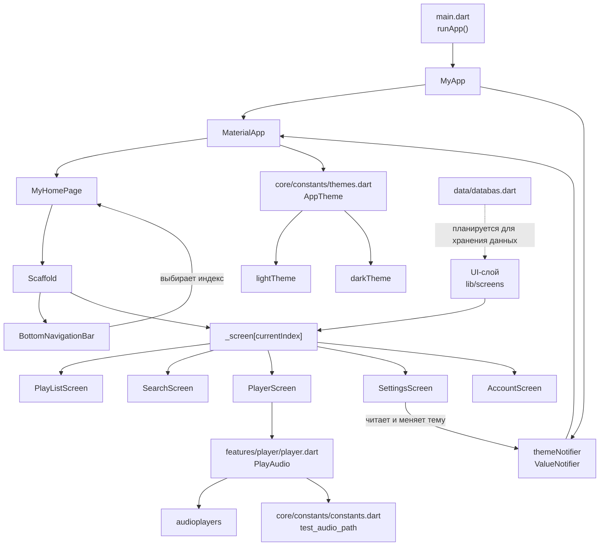

# Wave Player

Flutter-приложение с нижней навигацией между экранами плеера, поиска,
плейлистов, настроек и профиля.

## Архитектура

В проекте используется упрощённая архитектура с разделением на слои:

- `lib/main.dart` — точка входа приложения и корневой виджет `MyApp`.
- `lib/screens` — UI-экраны навигации и экранов приложения.
- `lib/features` — доменная/функциональная логика, например воспроизведение аудио.
- `lib/core/constants` — общие темы и константы.
- `lib/data` — подготовленный слой данных/БД для дальнейшего расширения.

## Getting Started
