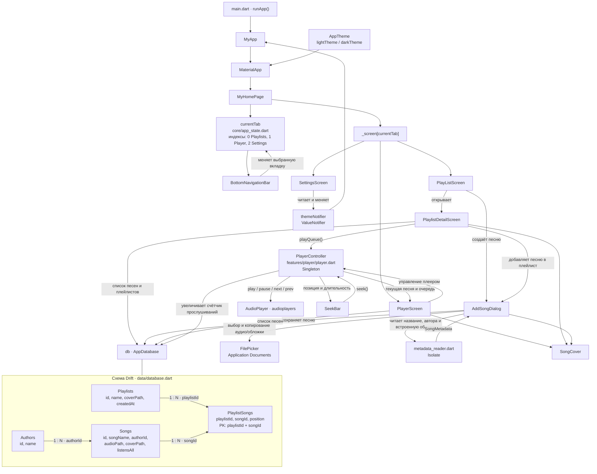

# Wave Player

Flutter-приложение с нижней навигацией между экранами плейлистов,
плеера и настроек.

## Архитектура

В проекте используется упрощённая архитектура с разделением на слои:

- `lib/main.dart` — точка входа, корневой виджет `MyApp` и нижняя навигация.
- `lib/screens` — основные экраны приложения.
- `lib/features` — сценарии плейлистов и управление воспроизведением.
- `lib/core` — состояние выбранной вкладки и тема приложения.
- `lib/data` — Drift-база данных, запросы и представление песни.
- `lib/widgets` — повторно используемые UI-компоненты.

## Getting Started
